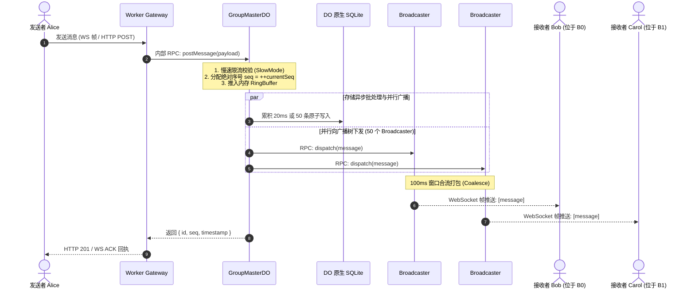

# 10 万人超大群架构设计规范 (100K-Member Supergroup Architecture)

> **设计目标**：  
> 构建一个单群能够稳定支撑 **100,000 人在线**、具备 **亚 30ms 广播投递延迟**、**绝对单调自增保序**、**零 D1 全局锁争用**、并且与现有 Web3 Chat 系统 100% 平滑兼容的云原生高并发即时通讯架构。

---

## 1. 核心瓶颈与破局推演 (Why & How)

### 1.1 物理上限的数学推演
- **单线程 CPU 墙**：Durable Object (DO) 是单线程执行（1 个 vCPU）。若向 100,000 个 WebSocket 遍历执行 `ws.send()`，即使每次调用耗时仅 0.003ms，单次广播耗时即达 **300ms**。在每秒多条消息并发下，单线程事件循环将彻底被广播占满并崩溃。
- **单实例 128MB 内存墙**：每个保持活跃的 WebSocket 连接占用底层套接字与元数据 2~3KB，10 万连接需要 200MB~300MB 内存，必然触发 DO 进程 OOM 终止。
- **D1 单写者硬瓶颈**：D1 底层单 Leader SQLite 的写并发上限为 50~200 QPS，10 万人群的高频刷屏和已读 ACK 会瞬间摧毁 D1。

### 1.2 破局三原则 (The Three Pillars)
1. **职责分离（Separation of Concerns）**：将 **“定序与持久化（Ordering & Persistence）”** 与 **“扇出广播（Fan-out Broadcasting）”** 彻底解耦。
2. **分层分片树（Hierarchical Fan-Out Tree）**：由主控单例负责分配全序 ID，由 50 个动态广播分片并发推送给最终客户端。
3. **存储彻底去中心化（Storage Sharding）**：群消息 100% 写入群专属 DO 原生内置的 SQLite 存储，D1 退化为纯只读元数据与权限中心。

---

## 2. 整体物理拓扑与架构蓝图

```mermaid
flowchart TD
    subgraph ClientTier["客户端层 (100,000 并发用户)"]
        Sender["发言用户 A"]
        subgraph SubClients1["用户 1 ~ 2,000"]
            U1["客户端 1"]
            U2["客户端 2000"]
        end
        subgraph SubClients2["用户 2,001 ~ 4,000"]
            U3["客户端 2001"]
            U4["客户端 4000"]
        end
        subgraph SubClientsN["用户 98,001 ~ 100,000"]
            U5["客户端 98001"]
            U6["客户端 100000"]
        end
    end

    subgraph EdgeTier["Cloudflare 边缘路由层 (Worker Gateway)"]
        Gateway["Worker 入口 (鉴权 / 路由分配 / HTTP代理)"]
    end

    subgraph CoreDOTier["核心主控层 (GroupMasterDO - 单例)"]
        MasterDO["GroupMasterDO\n- 状态仲裁与发言慢速限流\n- 绝对全序 seq_id 自增\n- 内存 RingBuffer (最新 500 条)\n- Auto-Batch 批量写入本地 SQLite\n- 管理活跃 Broadcaster 注册表"]
        MasterSQLite[("DO 本地原生 SQLite\n(该群专属数据库)")]
    end

    subgraph BroadcasterTier["二级扇出广播层 (GroupBroadcasterDO - 50 个分片)"]
        B1["Broadcaster DO #1\n(分片 0: 管理 2,000 WS)"]
        B2["Broadcaster DO #2\n(分片 1: 管理 2,000 WS)"]
        BN["Broadcaster DO #49\n(分片 49: 管理 2,000 WS)"]
    end

    Sender -->|1. 发送消息 (WS / HTTP)| Gateway
    Gateway -->|2. 路由转发| MasterDO
    MasterDO -->|3. Auto-Batch 落盘| MasterSQLite
    MasterDO -->|4. 并行 RPC 广播 (50 次调用，<5ms)| B1
    MasterDO -->|4. 并行 RPC 广播| B2
    MasterDO -->|4. 并行 RPC 广播| BN

    B1 -->|5. 100ms 帧合流推送| SubClients1
    B2 -->|5. 100ms 帧合流推送| SubClients2
    BN -->|5. 100ms 帧合流推送| SubClientsN

    SubClients1 -.->|WebSocket 握手| Gateway
    Gateway -.->|Hash: userId % 50| B1
    SubClients2 -.->|WebSocket 握手| Gateway
    Gateway -.->|Hash: userId % 50| B2
```

---

## 3. 核心组件详细设计

### 3.1 核心主控节点：`GroupMasterDO`
- **生命周期**：每个群全球唯一实例，ID 由 `env.GROUP_MASTER_DO.idFromName(groupId)` 确定。
- **职责**：
  1. **发言频率控制（Slow Mode）**：
     - 在 10 万人群中，普通成员默认受慢速模式限制（如 5 秒或 30 秒冷却），群主/管理员不受限。
     - 维护内存 `Map<userId, lastSendTimestamp>`，拦截高频轰炸。
  2. **绝对全序生成器**：
     - 维护单调递增整型 `currentSeq`。
     - 每条新消息分配唯一的递增 `seq`，彻底解决客户端接收乱序与空洞问题。
  3. **内存热缓存（RingBuffer）**：
     - 维护内存环形队列，常驻最近 500 条消息。
     - 客户端上线、断线重连补洞或翻看最新消息时，直接内存直出，零 I/O 延迟。
  4. **Auto-Batch 事务持久化**：
     - 进入 `pendingWrites` 暂存数组。
     - 达到 50 条或窗口满 20ms 时，执行 `ctx.storage.transactionSync` 批量写入 DO 原生 SQLite。
  5. **二级分发调度（Fan-out Dispatcher）**：
     - 记录当前活跃的 Broadcaster 数量（默认按群人数动态伸缩，10 万人配置 50 个分片）。
     - 通过 Cloudflare DO 之间的高速内部 RPC（`broadcasterStub.dispatchBatch([msg])`）并行下发给各 Broadcaster。50 次 RPC 调用在 Cloudflare 数据中心内部只需 2~5ms。

### 3.2 二级广播节点：`GroupBroadcasterDO`
- **生命周期**：按分片命名，ID 由 `env.GROUP_BROADCASTER_DO.idFromName(`${groupId}:shard_${shardId}`)` 确定。
- **职责**：
  1. **WebSocket 长连接管理**：
     - 每个 Broadcaster 实例仅管理约 **2,000 个** 客户端连接。
     - 使用 Cloudflare **Hibernatable WebSockets API**：空闲时自动休眠，无 CPU 计费开销；广播时由底层唤醒并下发。
  2. **广播合流与降频（Message Coalescing / 100ms 节拍）**：
     - 若 1 秒内收到 20 条新消息，Broadcaster 不会给每个客户端发送 20 次网络包。
     - 维护一个 **100ms 的推流合并窗口**：在 100ms 内收到的消息被打包为单个复合帧下发：
       ```json
       {
         "type": "messages_batch",
         "messages": [{ "seq": 101, ... }, { "seq": 102, ... }]
       }
       ```
     - 客户端每秒最多只触发 10 次渲染，彻底消除移动端发烫和掉帧。
  3. **连接路由分配算法**：
     - 用户建立 WebSocket 握手时，Gateway 计算：
       $$\text{shardId} = \text{fnv1a}(\text{userId}) \pmod{\text{TOTAL\_SHARDS}}$$
     - 客户端的 WS 请求直接升级到对应分片的 `GroupBroadcasterDO`。

### 3.3 数据库模型：DO 原生嵌入式 SQLite (`ctx.storage.sql`)
群消息持久化由每个群 DO 独立的 SQLite 数据库独占承载：

```sql
-- 1. 群消息核心表 (天然按照群物理隔离)
CREATE TABLE IF NOT EXISTS messages (
    seq INTEGER PRIMARY KEY,           -- 单调递增全序号 (1, 2, 3...)
    id TEXT UNIQUE NOT NULL,           -- 全局消息 UUID / 业务 ID
    sender_id TEXT NOT NULL,           -- 发送者地址 (0x...)
    type TEXT NOT NULL DEFAULT 'text', -- text / image / voice / file / recall
    content TEXT,                      -- 加密或明文消息体
    metadata TEXT,                     -- 媒体、提及(@)等 JSON 元数据
    created_at INTEGER NOT NULL        -- 毫秒时间戳
);

CREATE INDEX IF NOT EXISTS idx_messages_created_at ON messages(created_at);

-- 2. 游标水位线已读表 (Watermark ACK)
CREATE TABLE IF NOT EXISTS user_watermarks (
    user_id TEXT PRIMARY KEY,
    last_read_seq INTEGER NOT NULL,
    updated_at INTEGER NOT NULL
);
```

---

## 4. 核心工作流时序规范

### 4.1 消息发送与广播流水线 (Sub-30ms)



### 4.2 游标已读水位线机制 (Watermark ACK 消除写爆炸)
- **痛点**：传统群聊中 1 条消息被 10 万人阅读会产生 100,000 次数据库写入。
- **本架构解决方案**：
  1. 客户端在离开聊天室或滚动视图停顿后，发送单个水位线包：
     `{ action: "read_watermark", last_read_seq: 15200 }`
  2. 客户端直连的 `GroupBroadcasterDO` 接收该事件，**仅在内存中更新**：
     `broadcasterMemoryWatermarks.set(userId, last_read_seq)`
  3. Broadcaster 每隔 5 秒向 MasterDO 批量同步一次聚合字典；MasterDO 统一以 SQLite 事务批量更新 `user_watermarks`。
  4. 数据库写入被压缩了 **99.9%**。

### 4.3 客户端断线重连与全序补洞 (Gap-Filling Sync)
由于消息带有连续无空洞的自增 `seq`：
1. 客户端本地持久化存储当前已收到的最高序号 `local_last_seq = 1050`。
2. 手机网络中断 10 秒后重连，连入分配的 Broadcaster，发起握手携带：
   `{ action: "sync", since_seq: 1050 }`
3. Broadcaster 检查 MasterDO 的内存 RingBuffer：
   - 若 $1050 \ge \text{minSeq(RingBuffer)}$：**从内存中微秒级切片取出缺失消息**，单帧下发给客户端，完成 0ms 感知快速补洞。
   - 若客户端断线过久（缺失超过 500 条）：Broadcaster 从 DO SQLite 查表分页拉取补齐。

---

## 5. 动态弹性伸缩策略 (Small to 100K Groups)

系统必须避免“大炮打蚊子”，对不同规模的群组实行**自适应分级模式**：

| 群组活跃人数 | 广播分片数 (Broadcasters) | 广播策略 | 单月资源开销预期 |
| :--- | :--- | :--- | :--- |
| **小群 ($\le 500$ 人)** | **0 个** (MasterDO 直连广播) | MasterDO 单例同时负责定序与 WS 广播，无需分发树 | 极低（单个 DO 即可，休眠几乎 0 成本） |
| **中群 ($500 \sim 5,000$ 人)** | **2 ~ 3 个** | 用户分流到 2~3 个 Broadcaster 分片 | 低 |
| **大群 ($5,000 \sim 20,000$ 人)** | **10 个** | 10 个分片并发广播，开启 50ms 合流推流 | 中 |
| **超大群 ($20,000 \sim 100,000$ 人)**| **50 个** | 50 个分片并发广播，强制慢速发言与 100ms 帧合流 | 极高性价比 (仅在活跃期间消耗算力) |

---

## 6. 与现有系统的平滑兼容与过渡

1. **HTTP 接口 100% 保持兼容**：
   - 现有接口 `POST /conversations/:id/messages` 和 `GET /conversations/:id/messages` 继续有效。
   - Worker 路由层识别到该会话为群聊时，内部自动转发到 `GroupMasterDO`。老版本客户端无需修改即可享受全序保序与写性能提升。
2. **中心 D1 权限协同**：
   - 加群审核、群主转让、禁言/踢人继续在 D1 中维护。
   - `GroupMasterDO` 在内存中缓存成员角色列表（`roleCache`），缓存 TTL 为 60 秒或由管理员操作时发送 RPC 显式热失效。
3. **媒体资源 (Image/Voice/File)**：
   - 媒体二进制继续走已有的 R2 存储流水线。
   - 消息体中仅记录媒体的 R2 Key 与元数据，广播与分发流程完全复用本架构。

