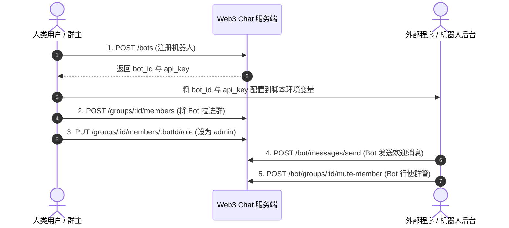

# Web3 Chat 机器人（Bot）开发者对接与功能指南

本文档全面介绍 Web3 Chat 机器人体系的架构设计、功能边界、用户端管理接口、开发者开放接口（OpenAPI）、进群与赋权流程，以及典型自动化场景的实战示例代码。

---

## 目录

1. [设计理念与核心特性](#1-设计理念与核心特性)
2. [机器人功能清单（机器人可以做哪些）](#2-机器人功能清单机器人可以做哪些)
3. [快速上手：三步接入机器人](#3-快速上手三步接入机器人)
4. [用户端管理接口（/bots）](#4-用户端管理接口bots)
5. [外部调用鉴权体系（5种凭据传递方式）](#5-外部调用鉴权体系5种凭据传递方式)
6. [机器人开放操作接口（/bot/*）](#6-机器人开放操作接口bot)
7. [进群与提拔管理员流程](#7-进群与提拔管理员流程)
8. [实战代码示例](#8-实战代码示例)
   - [示例一：Node.js/TypeScript 自动问答与迎新机器人](#示例一nodejstypescript-自动问答与迎新机器人)
   - [示例二：Python 群管监控（违规词自动禁言与踢人）](#示例二python-群管监控违规词自动禁言与踢人)
   - [示例三：cURL 常用运维命令速查](#示例三curl-常用运维命令速查)
9. [权限与安全规则（FAQ）](#9-权限与安全规则faq)

---

## 1. 设计理念与核心特性

传统 Telegram 机器人需要通过 `@BotFather` 经历冗长繁琐的对话状态机，且需要外部 Webhook 域名配置。本项目采用**极简、现代化且高性能**的设计：

- **零门槛自助注册**：任何已连接钱包的用户都可以通过单个 REST API 创建属于自己的机器人，立即获得专属 `bot_id` 与明文 `api_key`。
- **系统原生虚拟用户（Virtual User）**：机器人底层在 `users` 核心表中具备完整实体，与现有群聊成员管理、消息已读回执、双向拉黑、增量同步（`/sync`）等体系 100% 互通，无额外异构状态负担。
- **高性能 D1 写入优化**：底层严格遵循 [`docs/DATABASE_BATCHING_RULES.md`](DATABASE_BATCHING_RULES.md)，所有创建/更新/删除操作均采用原子 `db.batch()` 提交，鉴权与私聊守卫均经过查询合并（单次往返），彻底消弭锁争用与往返延迟。
- **灵活的群管特权（Admin Speech Invariance）**：当机器人被提拔为群管理员后，即使全群处于禁言状态，机器人依然可以正常广播消息（"admin始终可以讲话"）。

---

## 2. 机器人功能清单（机器人可以做哪些）

| 维度 | 功能项 | 对应 API | 典型应用场景 |
| :--- | :--- | :--- | :--- |
| **消息通讯** | 发送文本消息 | `POST /bot/messages/send` | 定时广播、资讯推送、预警通知 |
| | 发送动态贴纸 | `POST /bot/messages/send` (`type: "sticker"`) | 氛围渲染、情绪表达 |
| | `@`群成员艾特提醒 | `POST /bot/messages/send` (`mentions: ["0x..."]`) | 迎新点名、违规警告 |
| | 设定自毁/过期时长 | `POST /bot/messages/send` (`expires_in_seconds: 3600`) | 临时验证码、限时群通知 |
| | 1:1 私聊对话 | `POST /bot/messages/send` | 客服支持、AI 智能助手、私信指令 |
| **群聊管理** | 违规踢出成员 | `POST /bot/groups/:id/kick` | 广告小号清理、违规人员移出 |
| | 全员禁言 / 解除禁言 | `POST /bot/groups/:id/mute` | 夜间免打扰、群维护模式（管理员Bot发言不受限） |
| | 单人指定时长禁言 | `POST /bot/groups/:id/mute-member` | 刷屏警告、违规发言禁言1小时/1天 |
| | 更新群名 / 公告 / 简介 | `PATCH /bot/groups/:id` | 活动期间改名、同步今日置顶公告 |
| | 任命/解除群管理员 | `PUT /bot/groups/:id/members/:userId/role` | 若 Bot 为群主，可自主管理群管理团队 |
| | 机器人主动退群 | `POST /bot/groups/:id/leave` | 服务到期或任务完成后优雅离群 |
| **状态感知** | 查看所在群组列表 | `GET /bot/groups` | 盘点自己目前服务了哪些群 |
| | 查看群详情与角色 | `GET /bot/groups/:id` | 确认自己当前是普通成员还是管理员 |
| | 获取群成员名单 | `GET /bot/groups/:id/members` | 导出群成员名单、校验成员黑白名单 |
| | 读取会话消息历史 | `GET /bot/conversations/:id/messages` | 查询上下文、翻阅历史发言 |
| | 增量更新轮询 (Sync) | `GET /bot/sync` | 实时感知群内新消息并做出即时响应 |
| **群组加入** | 邀请码自主入群 | `POST /bot/groups/join` (`invite_token: "..."`) | 开发者通过邀请链接将机器人直接引入 |
| | 公开群自主加入 | `POST /bot/groups/join` (`group_id: "..."`) | 机器人自主漫游并服务公开社区 |

---

## 3. 快速上手：三步接入机器人



1. **第一步（用户注册）**：用户通过自己的钱包登录态调用 `POST /bots`，生成机器人并拿到 `bot_id` 与 `api_key`。
2. **第二步（拉入群组）**：群主在群聊中将机器人加入群组（按 `bot_id` 或唯一的 `bot_username` 添加），并可将其角色设为 `admin`。
3. **第三步（程序驱动）**：外部程序仅凭 `bot_id` 与 `api_key`，即可直接调用 `/bot/*` 系列接口管理群组或发送广播。

---

## 4. 用户端管理接口（/bots）

本组接口面向**人类拥有者（Owner）**，必须携带用户自身的登录令牌：`Authorization: Bearer <user_session_token>`。

### 4.1 注册机器人
- **路径**：`POST /bots`
- **请求体**：
  ```json
  {
    "name": "群管小助手",
    "username": "helper_bot",           // 可选，唯一 handle（3-32位英文数字下划线）
    "description": "24小时自动群管机器人", // 可选
    "avatar_url": "https://..."         // 可选
  }
  ```
- **成功响应** (201 Created)：
  > [!IMPORTANT]
  > 明文 `api_key` **仅在创建时或重置时返回一次**，数据库仅持久化安全哈希，请妥善保存。
  ```json
  {
    "bot": {
      "id": "bot_38b939fa041f4f81a7d65b1f0e495204",
      "owner_id": "0x1234567890abcdef1234567890abcdef12345678",
      "name": "群管小助手",
      "username": "helper_bot",
      "description": "24小时自动群管机器人",
      "avatar_url": "https://...",
      "api_key": "bot_sec_4bf8696d0ea44576a81fa04db14ec6dcf906371cbcf743bba1d8",
      "api_key_prefix": "bot_sec_4bf8696",
      "status": "active",
      "created_at": 1727670000000,
      "updated_at": 1727670000000
    }
  }
  ```

### 4.2 获取我的机器人列表
- **路径**：`GET /bots`
- **响应** (200 OK)：
  返回当前用户拥有的所有 Bot 列表（`api_key` 脱敏，仅展示 `api_key_prefix`）。

### 4.3 查看指定机器人详情
- **路径**：`GET /bots/:id`
- **响应** (200 OK)：返回指定 `id` 的机器人信息（仅限创建者访问）。

### 4.4 修改机器人资料与状态
- **路径**：`PATCH /bots/:id`
- **请求体**：
  ```json
  {
    "name": "升级版群管助手",
    "description": "更新后的简介",
    "avatar_url": "https://...",
    "status": "active" // 或 "disabled"（禁用后凭证立即失效）
  }
  ```

### 4.5 重置 API Key
- **路径**：`POST /bots/:id/reset-key`
- **响应** (200 OK)：旧 Key 立即失效，返回全新明文 `api_key`。

### 4.6 删除机器人
- **路径**：`DELETE /bots/:id`
- **响应** (200 OK)：原子物理删除该机器人，清理虚拟用户及其群内关联。

---

## 5. 外部调用鉴权体系（5种凭据传递方式）

外部调用方访问 `/bot/*` 系列接口时，无需复杂的钱包签名，只需传入 `bot_id` 与 `api_key`。系统支持以下任意一种格式（自由选用）：

| 方式 | 传递位置 | 格式示例 |
| :--- | :--- | :--- |
| **① 双请求头（推荐）** | Headers | `X-Bot-Id: bot_xxx`<br>`X-Bot-Key: bot_sec_yyy` |
| **② 单请求头（Telegram风格）** | Headers | `X-Bot-Token: bot_xxx:bot_sec_yyy` |
| **③ Bearer Token 形式** | Headers | `Authorization: Bearer bot_xxx:bot_sec_yyy` |
| **④ URL Query 参数** | Query | `GET /bot/me?bot_id=bot_xxx&api_key=bot_sec_yyy` |
| **⑤ POST JSON Body** | Body | `{ "bot_id": "bot_xxx", "api_key": "bot_sec_yyy", ... }` |

> [!TIP]
> 推荐在生产后端使用 **`X-Bot-Token: <bot_id>:<api_key>`** 格式，格式最整洁直观。

---

## 6. 机器人开放操作接口（/bot/*）

### 6.1 查看机器人自身资料
- **请求**：`GET /bot/me`
- **响应**：
  ```json
  {
    "bot": {
      "id": "bot_38b939fa041f4f81a7d65b1f0e495204",
      "name": "群管小助手",
      "username": "helper_bot",
      "description": "24小时自动群管机器人",
      "avatar_url": "https://...",
      "owner_id": "0x1234567890abcdef...",
      "status": "active"
    }
  }
  ```

### 6.2 查询机器人所在的群组列表
- **请求**：`GET /bot/groups` 或 `GET /bot/conversations`
- **响应**：
  ```json
  {
    "groups": [
      {
        "id": "0xowner_address:slug_group",
        "name": "Web3 官方交流群",
        "type": "group",
        "group_type": "public",
        "role": "admin",          // 机器人在该群内的角色: 'admin' | 'member' | 'owner'
        "member_count": 48,       // 群当前成员数
        "joined_at": 1727670100000,
        "updated_at": 1727670200000
      }
    ]
  }
  ```

### 6.3 获取群详情与群成员
- **获取群详情**：`GET /bot/groups/:id`
- **获取群成员**：`GET /bot/groups/:id/members`
  - 响应包含每个成员的 `user_id`、`wallet_address`、`role`、`group_nickname`、`is_muted`、`muted_until` 等。

### 6.4 发送消息（群聊 / 私聊）
- **请求**：`POST /bot/messages/send`
- **请求体**：
  ```json
  {
    "conversation_id": "0xowner:my_group",
    "content": "欢迎新成员 @0xabcd 加入我们！",
    "type": "text",                    // 支持 'text' 或 'sticker'
    "mentions": ["0xabcd1234..."],     // 可选，艾特的目标地址
    "expires_in_seconds": 86400        // 可选，消息保留秒数（默认 24 小时）
  }
  ```
- **发送动态贴纸**：
  ```json
  {
    "conversation_id": "0xowner:my_group",
    "content": "animated/U+2764_1",
    "type": "sticker"
  }
  ```

### 6.5 读取历史消息与增量同步更新
- **分页读取指定对话消息**：
  `GET /bot/conversations/:id/messages?limit=50&after_id=<message_id>`
- **增量更新轮询（实时监听新消息）**：
  `GET /bot/sync?since=<timestamp>&limit=100`
  - 返回自 `since` 时间戳之后该机器人收到的所有群聊与私聊消息，便于监听互动。

### 6.6 群组管理：踢出违规成员
- **请求**：`POST /bot/groups/:id/kick`
- **请求体**：
  ```json
  {
    "user_id": "0xbadactor..." // 或传 wallet_address
  }
  ```
- **权限约束**：机器人必须是群的 `owner` 或 `admin`；严禁踢出群主。

### 6.7 群组管理：全员禁言与解除
- **请求**：`POST /bot/groups/:id/mute`
- **请求体**：
  ```json
  {
    "muted": true,                // true 开启全员禁言，false 解除禁言
    "duration_seconds": 3600      // 可选，禁言时长（秒）；不传或为 0 则为永久禁言直到手动解禁
  }
  ```
- **特权提示**：全员禁言期间，群主与管理员（包括本 Bot）不受发言限制。

### 6.8 群组管理：对单个成员禁言/解禁
- **请求**：`POST /bot/groups/:id/mute-member`
- **请求体**：
  ```json
  {
    "user_id": "0xspammer...",
    "muted": true,                // true 禁言，false 解除禁言
    "duration_seconds": 1800,     // 禁言 30 分钟
    "reason": "发送违规杀猪盘链接"  // 可选，记录禁言原因
  }
  ```

### 6.9 群组管理：更新群资料与公告
- **请求**：`PATCH /bot/groups/:id`
- **请求体**：
  ```json
  {
    "name": "新群名称",
    "description": "群最新介绍",
    "announcement": "重要通知：今晚 20:00 举行社区 AMA 活动！"
  }
  ```

### 6.10 机器人自主加入与离开群聊
- **加入群聊**：`POST /bot/groups/join`
  - 公开群：`{ "group_id": "..." }`
  - 邀请链接：`{ "invite_token": "..." }`
- **主动退群**：`POST /bot/groups/:id/leave`

---

## 7. 进群与提拔管理员流程

### 方式一：群主/管理员直接邀请进群（最简单常用）
群主或现有管理员调用常规群成员添加接口：
```http
POST /groups/:groupId/members
Authorization: Bearer <owner_or_admin_token>
Content-Type: application/json

{
  "user_id": "helper_bot" // 可以直接传 Bot 的 username，也可以传 bot_id
}
```

### 方式二：提拔机器人为群管理员
只有当机器人是 `admin` 或 `owner` 时，才能行使踢人、禁言、修改群公告等权限：
```http
PUT /groups/:groupId/members/<bot_id>/role
Authorization: Bearer <owner_token>
Content-Type: application/json

{
  "role": "admin"
}
```

---

## 8. 实战代码示例

### 示例一：Node.js/TypeScript 自动问答与迎新机器人

```typescript
import axios from 'axios';

const BASE_URL = 'https://web3-chat-worker.002788.xyz';
const BOT_ID = process.env.BOT_ID!;
const BOT_KEY = process.env.BOT_KEY!;

const api = axios.create({
  baseURL: BASE_URL,
  headers: {
    'X-Bot-Token': `${BOT_ID}:${BOT_KEY}`,
    'Content-Type': 'application/json',
  },
});

let lastSyncTs = Date.now();

async function pollMessages() {
  try {
    const res = await api.get(`/bot/sync?since=${lastSyncTs}`);
    const { messages, sync_timestamp } = res.data;
    if (sync_timestamp) lastSyncTs = sync_timestamp;

    for (const msg of messages) {
      // 忽略自己发送的消息
      if (msg.sender_id === BOT_ID) continue;

      // 1. 监听系统事件：新成员进群自动发送欢迎语
      if (msg.type === 'system') {
        const eventData = JSON.parse(msg.content || '{}');
        if (eventData.event === 'member_joined') {
          await api.post('/bot/messages/send', {
            conversation_id: msg.conversation_id,
            content: `🎉 欢迎新朋友 @${eventData.wallet_address} 加入本群！请阅读群公告遵守发言规则。`,
            mentions: [eventData.wallet_address],
          });
        }
      }

      // 2. 关键词问答：例如回复 "/help"
      if (msg.type === 'text' && msg.content?.trim() === '/help') {
        await api.post('/bot/messages/send', {
          conversation_id: msg.conversation_id,
          content: '🤖 我是群管助手，支持以下指令：\n- /help: 查看帮助\n- /rules: 查看群规',
        });
      }
    }
  } catch (err: any) {
    console.error('Polling error:', err.response?.data || err.message);
  } finally {
    setTimeout(pollMessages, 2000); // 2秒轮询一次
  }
}

// 启动机器人
pollMessages();
```

---

### 示例二：Python 群管监控（违规词自动禁言与踢人）

```python
import time
import requests

BASE_URL = "https://web3-chat-worker.002788.xyz"
BOT_ID = "bot_your_bot_id_here"
BOT_KEY = "bot_sec_your_bot_key_here"

headers = {
    "X-Bot-Token": f"{BOT_ID}:{BOT_KEY}",
    "Content-Type": "application/json"
}

BAD_WORDS = ["免费空投", "私聊加微信", "代币翻倍", "兼职刷单"]
last_ts = int(time.time() * 1000)

print(f"[*] 机器人 {BOT_ID} 群管风控守护已启动...")

while True:
    try:
        resp = requests.get(f"{BASE_URL}/bot/sync?since={last_ts}", headers=headers, timeout=10)
        data = resp.json()
        last_ts = data.get("sync_timestamp", last_ts)

        for msg in data.get("messages", []):
            if msg.get("sender_id") == BOT_ID:
                continue

            content = msg.get("content", "")
            conv_id = msg.get("conversation_id")
            sender = msg.get("sender_id")

            # 检测违规广告敏感词
            if any(bad in content for bad in BAD_WORDS):
                print(f"[!] 发现违规内容: '{content}' 来自 {sender}")

                # 1. 禁言该违规用户 2 小时 (7200秒)
                requests.post(
                    f"{BASE_URL}/bot/groups/{conv_id}/mute-member",
                    json={"user_id": sender, "muted": True, "duration_seconds": 7200, "reason": "发送违禁广告"},
                    headers=headers
                )

                # 2. 发送群内警示通知
                requests.post(
                    f"{BASE_URL}/bot/messages/send",
                    json={"conversation_id": conv_id, "content": f"⚠️ 用户已因涉嫌广告刷屏被系统自动禁言 2 小时。"},
                    headers=headers
                )

    except Exception as e:
        print("[!] 轮询发生异常:", e)

    time.sleep(2)
```

---

### 示例三：cURL 常用运维命令速查

```bash
# 环境变量配置
export BOT_ID="bot_xxxxxxxx"
export BOT_KEY="bot_sec_yyyyyyyy"
export API_URL="https://web3-chat-worker.002788.xyz"

# 1. 查看机器人自身信息
curl -H "X-Bot-Token: $BOT_ID:$BOT_KEY" "$API_URL/bot/me"

# 2. 发送群通知
curl -X POST "$API_URL/bot/messages/send" \
  -H "X-Bot-Token: $BOT_ID:$BOT_KEY" \
  -H "Content-Type: application/json" \
  -d '{"conversation_id": "group_123", "content": "系统广播：维护已完成"}'

# 3. 开启群全员禁言 1 小时
curl -X POST "$API_URL/bot/groups/group_123/mute" \
  -H "X-Bot-Token: $BOT_ID:$BOT_KEY" \
  -H "Content-Type: application/json" \
  -d '{"muted": true, "duration_seconds": 3600}'

# 4. 踢出指定用户
curl -X POST "$API_URL/bot/groups/group_123/kick" \
  -H "X-Bot-Token: $BOT_ID:$BOT_KEY" \
  -H "Content-Type: application/json" \
  -d '{"user_id": "0xviolator_address"}'
```

---

## 9. 权限与安全规则（FAQ）

#### Q1: 机器人调用群管接口（如踢人、禁言）返回 `403 Forbidden`？
- **原因**：机器人进群后默认是普通成员（`member`）。
- **解决办法**：群主需调用 `PUT /groups/:id/members/<bot_id>/role` 传入 `{"role": "admin"}` 将 Bot 提升为管理员。

#### Q2: 机器人能够踢出群主吗？
- **保护机制**：不能。系统底层 RBAC 严格禁止踢出群主或降低群主权限；即使 Bot 被赋予 admin 尝试踢出 owner，系统也会强制拒绝并返回 `403 Forbidden`。

#### Q3: 全员禁言期间，机器人还能在群里讲话吗？
- **特权机制**：可以。系统遵循 **"admin始终可以讲话"** 守卫准则，当群被全员禁言时，只有普通成员（`member`）会被拦截，管理员角色（包括管理员 Bot）享有广播豁免权。

#### Q4: 用户与机器人私聊是否需要提前加好友？
- **免加好友直接对话**：不需要。人类用户与普通人类私聊默认要求双向互为好友，但对于机器人，系统已开放特许：任何用户都可以直接给机器人发私信，机器人也能直接给用户回信。用户若不想再受打扰，可随时将机器人加入黑名单（Blacklist）。

#### Q5: 机器人的 API Key 不慎泄露怎么办？
- **一键重置**：机器人创建者随时可在控制台或调用 `POST /bots/:id/reset-key`，系统会瞬间作废旧密钥并生成新密钥，旧密钥发起的所有请求将立即返回 `401 Unauthorized`。
